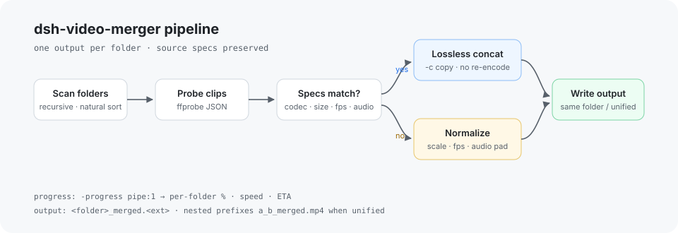
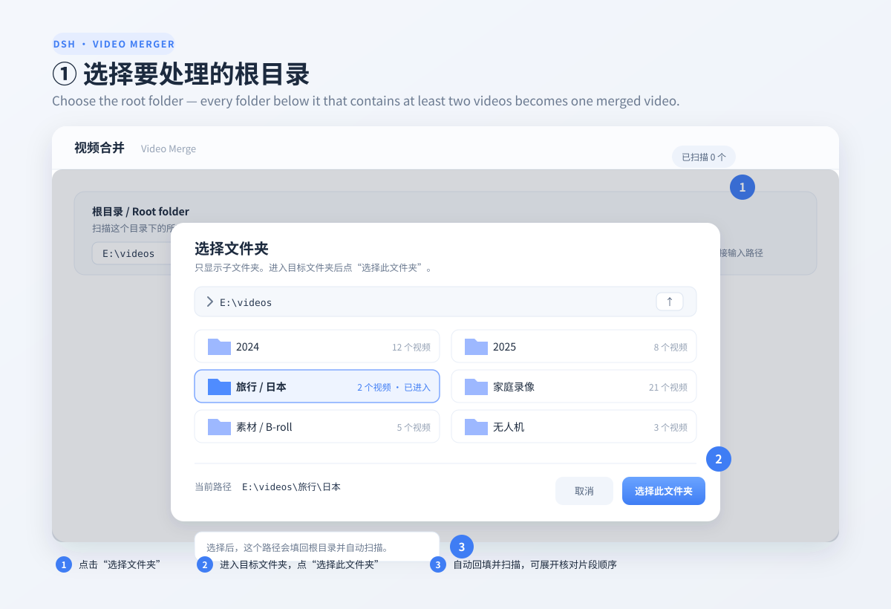
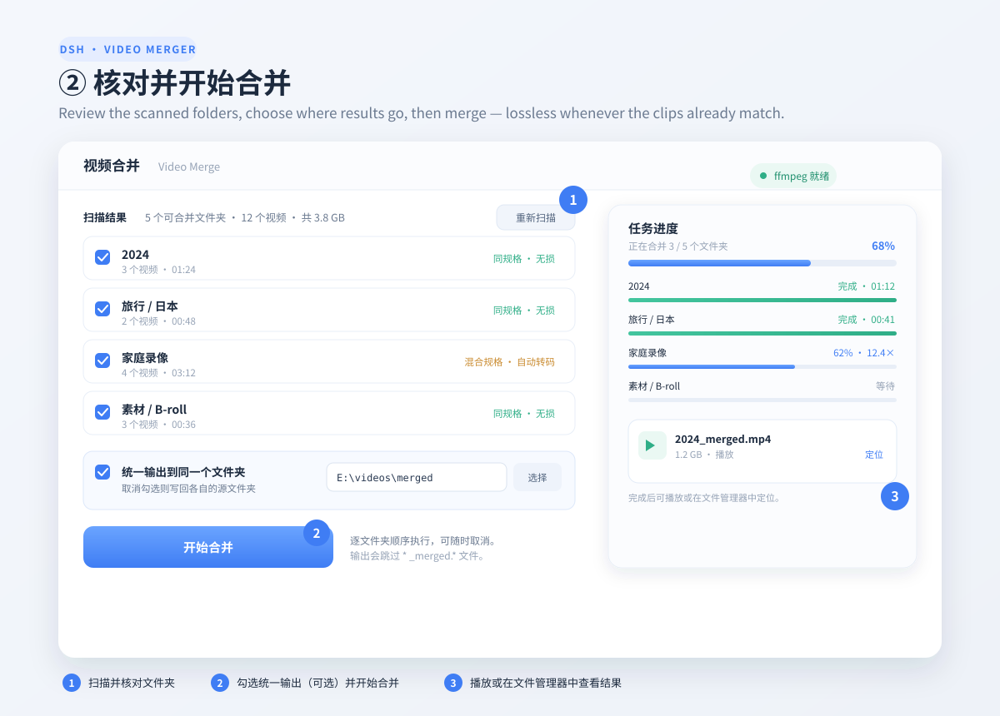

# dsh-video-merger

**Merge every folder's videos into one file — without changing the video spec.**

A [DeepSeek Harness](https://github.com/deepseek-ai) plugin that scans a folder
tree, groups the videos by folder, and writes one merged video per folder. When
the clips in a folder already share the same codec, resolution, frame rate,
pixel format, and audio layout, the merge is a **lossless remux** (`-c copy`).
Only mixed folders are normalized, and then to the first clip's spec.

按文件夹合并视频：每个包含至少 2 个视频的文件夹生成一个合并文件。规格一致时
无损拼接、不重新编码；规格不一致时才转码对齐到第一个视频。

[](https://github.com/a-mochis/dsh-video-merger/actions/workflows/ci.yml)
[](LICENSE)
[](package.json)
[](package.json)



## Contents

- [Features](#features)
- [Requirements](#requirements)
- [Install](#install)
- [Usage](#usage)
- [Screenshots](#screenshots)
- [Output rules](#output-rules)
- [How it works](#how-it-works)
- [ffmpeg resolution](#ffmpeg-resolution)
- [Development](#development)
- [Limitations](#limitations)
- [License](#license)
- [中文说明](#中文说明)

## Features

- **Folder-aware.** Recursively scans a root folder, groups clips per folder, and
  merges every folder with at least two videos. Natural file-name ordering.
- **Lossless by default.** Matching clips are concatenated with the ffmpeg concat
  demuxer and stream copy. No quality loss, no re-encode, same container.
- **Automatic fallback.** Mixed resolutions, frame rates, codecs, or audio layouts
  are normalized to the first clip, then concatenated.
- **Optional unified output.** Put every result in one folder (defaults to the
  scanned root), or keep the original per-folder layout.
- **Web UI.** In-app directory browser, folder checklist, live progress, speed,
  ETA, cancel, play, and reveal in file manager.
- **Two more entry points.** The `merge_folder_videos` DSH tool and a standalone
  CLI, both using the same engine.
- **ffmpeg bootstrap.** Detects an existing install; on Windows the UI can download
  a known-good build.

## Requirements

- DeepSeek Harness with the Web UI (desktop or browser profile).
- `ffmpeg` and `ffprobe` for the actual merge. Put them on `PATH`, point the plugin
  at their folder, or use the Windows auto-download.
- Node.js 20+ only if you use the CLI or run the tests.

## Install

Clone this repository somewhere stable, then install the folder as a DSH bundle.
In DSH, call the `plugin_manager` tool:

```text
plugin_manager install_bundle target = <absolute path to dsh-video-merger>
```

For example:

```bash
git clone https://github.com/a-mochis/dsh-video-merger.git
```

```text
plugin_manager install_bundle target = E:\code\6-plugins\dsh-video-merger
```

Or download the packaged zip from the [latest release](https://github.com/a-mochis/dsh-video-merger/releases/latest),
unzip it, and install the extracted folder the same way.

After installing or updating, force-refresh the Web UI (`Ctrl+Shift+R`). Open any
session and choose the **视频合并 / Video Merge** tab in the session tab bar.

### Install from Discover

The repository also publishes a one-plugin market index. In DSH open
**Plugins → Discover → Index sources → Add index source** and paste:

```text
https://cdn.jsdelivr.net/gh/a-mochis/dsh-video-merger@main/market/index.json
```

The **Video Merger** card then appears in Discover and installs the same bundle.
This is a personal index hosted beside the project, not an entry in the curated
community catalog.

> The plugin has no runtime npm dependencies. `npm install` is only needed for
> the client tests (`react` / `react-dom` are dev dependencies).

## Usage

### Web UI

1. Open the **视频合并** tab.
2. Choose a root folder. The built-in browser supports entering folders, going up,
   and typing a path directly. Click **选择此文件夹** to confirm.
3. Review the folder list and uncheck anything you do not want to merge. Expand a
   folder to inspect clip order.
4. Leave **统一输出到同一个文件夹** checked to collect all results in one place
   (the output path defaults to the scanned root), or uncheck it to write each
   result back into its source folder.
5. Click **开始合并**. Progress, speed, and ETA are shown per folder and overall.
6. Play the result or reveal it in the file manager when the job finishes.

### Screenshots

**1. Choose the root folder.** Click **选择文件夹 / Select folder**, browse into the
target folder in the built-in browser, then click **选择此文件夹 / Select this folder**.
The path is filled back and scanned automatically.



**2. Review and merge.** Check the folders you want, leave **统一输出到同一个文件夹**
checked to collect every result in one place (the root by default), then click
**开始合并 / Start merge**. Progress, speed, and the finished output are shown per folder.



### Tool

```text
merge_folder_videos root="E:\videos" recursive=true outputDir="E:\videos\merged"
```

| Argument | Default | Meaning |
| --- | --- | --- |
| `root` | required | Root directory to scan. |
| `folder` | – | Merge only this folder instead of scanning `root`. |
| `recursive` | `true` | Scan sub-folders. |
| `order` | `name` | Clip order: `name` or `mtime`. |
| `overwrite` | `false` | Overwrite an existing output instead of auto-renaming. |
| `reencodeFallback` | `true` | Normalize folders whose clips have different specs. |
| `deleteSource` | `false` | Delete source clips after a successful merge. |
| `outputDir` | – | Put every result in this folder (created if missing). |
| `wait` | `true` | Wait for completion; `false` returns a job id immediately. |

### CLI

```bash
node bin/merge-videos.mjs "E:\videos" --out "E:\videos\merged"
```

```text
--no-recursive        scan only the root folder
--folder <path>       merge only this folder
--order name|mtime    clip order (default: name)
--out <dir>           unified output folder
--overwrite           overwrite existing *_merged output
--no-reencode         skip folders whose clips have mismatched specs
--delete-source       delete source clips after a successful merge
--ffmpeg <dir>        directory containing ffmpeg and ffprobe
--json                print the final job snapshot as JSON
```

Exit codes: `0` all succeeded, `1` at least one failure, `2` bad arguments,
`3` ffmpeg/ffprobe not found.

## Output rules

- Name: `<folder>_merged.<original extension>`.
- Unified mode uses the folder's path relative to the scan root as a prefix, so
  `root/a/b/` becomes `a_b_merged.mp4` instead of colliding with `root/a/`.
- Reserved Windows characters are replaced with `_`; an empty name becomes `merged`.
- Existing outputs are auto-renamed with ` (1)`, ` (2)`, … unless **overwrite** is on.
- Files matching `*_merged.*` are ignored on the next scan, so you can safely scan
  the same tree again.
- The source clips are never deleted unless `deleteSource` / `--delete-source` is set.

## How it works

```text
scan folders → ffprobe every clip → compare signatures
                                    ├─ equal   → concat demuxer + -c copy
                                    └─ unequal → normalize to first clip
                                                 (scale/pad/fps/yuv420p/audio)
                                              → concat demuxer + -c copy
```

The signature used for the comparison is:

```text
video: codec | width | height | pixel format | frame rate
audio: codec | sample rate | channels        (or "no audio")
```

- **Lossless path:** `-f concat -safe 0 -i list -map 0:v:0 -map 0:a? -c copy`
  with `-fflags +genpts -avoid_negative_ts make_zero`.
- **Normalize path:** scales and pads to the target size, converts to `yuv420p`,
  forces the target frame rate, encodes H.264 (`libx264`, `veryfast`, CRF 18) and
  AAC 192 kbps. A silent track is generated when the target has audio but a clip
  does not.
- Progress comes from `-progress pipe:1 -nostats` (`out_time_us` and `speed`).

## ffmpeg resolution

Checked in this order:

1. The folder configured in the plugin (Web UI → **指定 ffmpeg 目录**).
2. `FFMPEG_DIR`, then `FFMPEG_PATH`.
3. `%DSH_HOME%/plugin-data/dsh-video-merger/bin` (managed download).
4. Directories on `PATH`.
5. A few common install locations.

The configuration file is
`%DSH_HOME%/plugin-data/dsh-video-merger/config.json` (`$DSH_HOME` or `~/.dsh`
when the variable is unset). The detection result is cached for 15 seconds.

The in-app download is Windows-only and fetches the gyan.dev "essentials" build.
On macOS/Linux install ffmpeg with your package manager, for example:

```bash
brew install ffmpeg          # macOS
sudo apt install ffmpeg      # Debian / Ubuntu
```

## Development

```bash
npm install
npm run check       # node --check for every runtime file
npm test            # directory-listing normalization + React SSR
npm run test:merge  # generates synthetic clips, merges them, asserts specs
```

`npm run test:merge` creates `test/fixtures/` and `test/output/` with ffmpeg
`lavfi` sources (two identical clips, mixed resolutions, Matroska, an apostrophe
in the file name, missing audio, and a single-clip folder). Both directories are
git-ignored; no test media is committed.

The client tests load `lib/client.js` through the same
`window.__ModuleLoader__` wrapper the Harness uses. If React is not installed
locally, set `DSH_PROFILE_PACKAGE` to a DSH profile's `package.json` path.

See [CONTRIBUTING.md](CONTRIBUTING.md) for the development install flow and PR
expectations.

## Limitations

- A folder needs at least two videos; a single clip is skipped.
- "Lossless" requires an exact signature match. Otherwise the folder is
  re-encoded once, which is inherently lossy.
- Subtitles, chapters, and per-clip metadata are not specifically preserved.
- Merging very large folders needs temporary disk space roughly equal to the
  output size.
- Auto-download of ffmpeg is Windows-only.

## License

[MIT](LICENSE) © 2026 a-mochis

---

## 中文说明

### 功能

- 递归扫描根目录，每个含至少 2 个视频的文件夹合并成一个文件。
- 规格一致时使用 concat demuxer + `-c copy`，**无损、不重新编码**。
- 规格不一致时（默认开启）以第一个视频为基准转码对齐，再拼接；缺失音轨的片段
  会补静音。
- 可把所有结果统一输出到一个文件夹（默认扫描根目录），也可以保持写回各源文件夹。
- Web UI 支持目录浏览、文件夹勾选、实时进度、取消、播放和定位。
- 同时提供 `merge_folder_videos` 对话工具和 `bin/merge-videos.mjs` 命令行。

### 安装

```bash
git clone https://github.com/a-mochis/dsh-video-merger.git
```

在 DSH 中调用：

```text
plugin_manager install_bundle target = <dsh-video-merger 的绝对路径>
```

The profile package can also be installed from a terminal with the DSH CLI:

```bash
dsh plugin --profile desktop add git+https://github.com/a-mochis/dsh-video-merger.git
```

`plugin_manager install_bundle` additionally enables the bundle in the profile;
after a bare `dsh plugin add`, make sure `dsh-video-merger` is listed under
`dsh.profile.bundles` in the profile's `package.json`.

安装或更新后强制刷新页面，在会话顶部打开「视频合并」。

### 使用

- 图形界面：选根目录 → 勾选文件夹 → 按需勾选「统一输出」→ 开始合并。

#### 界面示意

**1. 选择根目录**：点「选择文件夹」，在插件自带的目录浏览器中进入目标文件夹，
再点「选择此文件夹」。路径会回填并自动扫描。


**2. 核对并合并**：勾选要处理的文件夹；「统一输出到同一个文件夹」默认勾选，
留空即输出到扫描根目录；点「开始合并」后可查看总进度、速度和结果。


- 工具：`merge_folder_videos root="E:\videos" outputDir="E:\videos\merged"`。
- 命令行：`node bin/merge-videos.mjs "E:\videos" --out "E:\videos\merged"`。

输出命名 `<文件夹名>_merged.<原扩展名>`；统一输出时嵌套目录会带相对路径前缀
（如 `a_b_merged.mp4`），重名默认自动加 ` (1)`，勾选覆盖则直接覆盖。

### 测试

```bash
npm install
npm test
npm run test:merge
```

测试会用 ffmpeg 的 `lavfi` 现场生成素材，覆盖同规格、混合分辨率、MKV、文件名
带单引号、缺音轨和单视频文件夹。

### 许可

[MIT](LICENSE) © 2026 a-mochis
